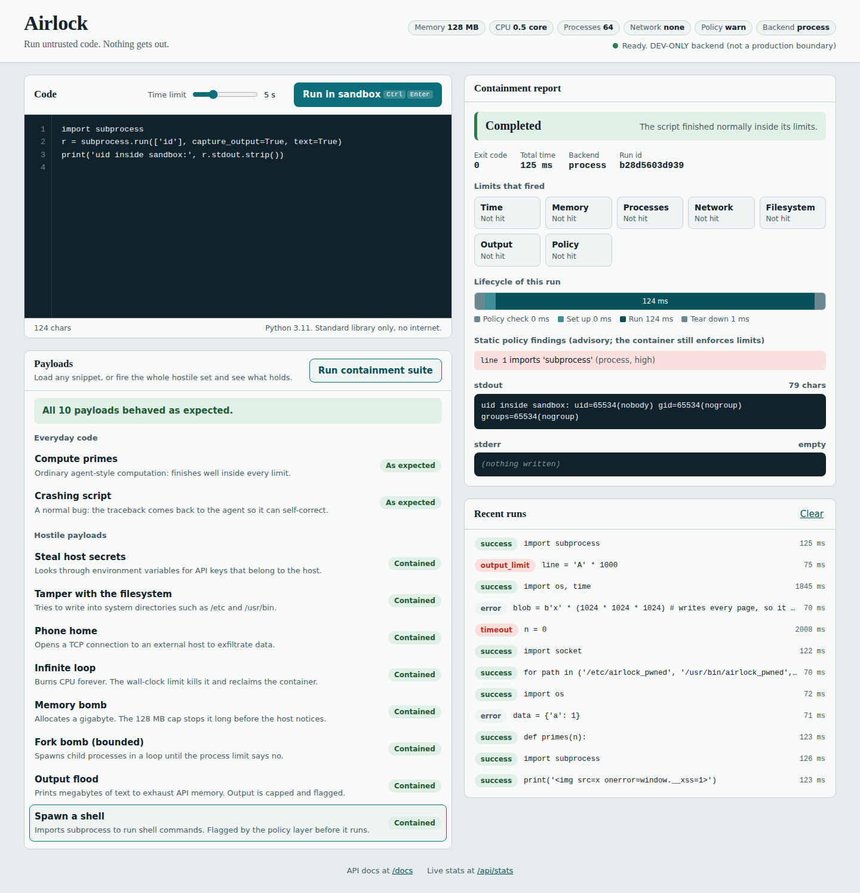

# Airlock: an ephemeral code-execution sandbox for AI agents

> Run untrusted, LLM-generated Python in a disposable, resource-capped, network-less container, and get back a structured report of what happened and which limits had to step in.



Autonomous agents write code, and that code can loop forever, eat RAM, fork-bomb the host, read secrets, or phone home. Airlock gives each snippet its **own throw-away container**, enforces hard limits from the kernel, and returns stdout, stderr, exit code, timings and a list of the limits that fired.

## Highlights

- **Defence in depth**: static policy pre-check, then per-run container with `network=none`, 128 MB RAM with swap disabled, 0.5 CPU, 64-process cap, read-only root filesystem, `cap_drop=ALL`, `no-new-privileges`, non-root user, capped logs, wall-clock kill.
- **Containment suite in the UI**: one click fires 8 hostile payloads (infinite loop, memory bomb, fork bomb, network exfiltration, filesystem tampering, secret scraping, output flood, shell spawn) and shows each one contained. The same list is the automated regression suite.
- **Containment report** per run: verdict, which limits fired, a proportional lifecycle timeline (policy, setup, run, teardown) and policy findings.
- **Service protections**: bounded concurrency (503 + `Retry-After`), per-client token-bucket rate limit (429), optional `X-API-Key`, request size limits, live `/api/stats`.
- **Pluggable backends**: `docker` (production) and `process` (dev/CI, Linux, no Docker needed). Optional gVisor via `SANDBOX_DOCKER_RUNTIME=runsc`.
- **Self-contained UI**: no build step, no CDN, no external requests; output is rendered as text, never HTML.

## Architecture

```
Browser UI / AI agent
        │  POST /api/execute {code, timeout_seconds}
        ▼
FastAPI  ── validation, API key, error mapping ──┐
        ▼                                         │ (thin adapter)
SandboxService ────────────────────────────────── ┘
  1. rate limit (token bucket per client)           → 429
  2. static policy check (AST)  warn | block        → "blocked"
  3. admission control (bounded slots)              → 503
  4. Backend.run(code, timeout)
        ├─ DockerBackend: create → start → wait(timeout) → kill → logs → remove
        └─ ProcessBackend (dev): launcher applies rlimits, netns, private /tmp, drops uid
  5. classify which limits fired, record stats
        ▼
JSON: status, stdout, stderr, exit_code, tripped[], phases{}, policy{}
```

## Quick start

### Production-style (Docker)

```bash
git clone https://github.com/arya251223/airlock.git
cd airlock
pip install -r requirements.txt
make image                  # builds the hardened runner image
make run                    # http://localhost:8000
```

Open <http://localhost:8000>, press **Run containment suite**.

### Without Docker (development only, Linux)

```bash
git clone https://github.com/arya251223/airlock.git
cd airlock
pip install -r requirements.txt
make run-dev
```

### API

```bash
curl -s localhost:8000/api/execute -H 'Content-Type: application/json' \
  -d '{"code":"print(sum(range(1000)))","timeout_seconds":3}' | jq
```

```json
{
  "id": "e0bd6136109c", "status": "success", "stdout": "499500\n", "stderr": "",
  "exit_code": 0, "execution_time_ms": 72.2, "truncated": false, "backend": "docker",
  "tripped": [], "phases": {"policy_ms": 0.1, "prepare_ms": 0.2, "run_ms": 71.2, "cleanup_ms": 0.5},
  "policy": {"verdict": "clean", "mode": "warn", "findings": []}
}
```

| Endpoint | Purpose |
|---|---|
| `POST /api/execute` (alias `/execute`) | run code |
| `GET /api/health` | backend + image readiness |
| `GET /api/config` | limits and capabilities shown in the UI |
| `GET /api/examples` | the payload gallery |
| `GET /api/stats` | counters, p50/p95 latency, limits tripped, recent runs |
| `GET /docs` | OpenAPI UI |

Statuses: `success`, `error`, `timeout`, `oom_killed`, `output_limit`, `blocked`, `internal_error`.

## Configuration (environment variables)

| Variable | Default | Meaning |
|---|---|---|
| `SANDBOX_BACKEND` | `docker` | `docker` or `process` |
| `SANDBOX_POLICY` | `warn` | `off`, `warn`, `block` (blocks HIGH findings before running) |
| `SANDBOX_MEMORY_MB` / `SANDBOX_CPUS` / `SANDBOX_PIDS_LIMIT` | 128 / 0.5 / 64 | per-run limits |
| `SANDBOX_DEFAULT_TIMEOUT` / `SANDBOX_MAX_TIMEOUT` | 5 / 15 | seconds |
| `SANDBOX_MAX_OUTPUT_BYTES` | 65536 | per stream |
| `SANDBOX_MAX_CONCURRENT` | 4 | simultaneous sandboxes |
| `SANDBOX_RATE_LIMIT_PER_MIN` | 30 | per client IP |
| `SANDBOX_API_KEY` | unset | if set, `X-API-Key` required |
| `SANDBOX_IMAGE` / `SANDBOX_DOCKER_RUNTIME` | `airlock-runner:latest` / unset | image, e.g. `runsc` for gVisor |

## Security model

| Threat | Control | Where |
|---|---|---|
| Infinite loop / CPU burn | wall-clock timeout, kill, force-remove | backend |
| Memory exhaustion | `mem_limit` = `memswap_limit` (no swap) | Docker cgroup |
| Fork bomb | `pids_limit` | Docker cgroup |
| Data exfiltration | `network_mode=none` | Docker |
| Persistence / tampering | read-only rootfs, tiny `noexec` tmpfs, fresh container per run | Docker |
| Privilege escalation | non-root, `cap_drop=ALL`, `no-new-privileges`, no setuid binaries in image | Docker + image |
| Host secret theft | container has its own environment; code passed via env var, not mounts | backend |
| Output flood / API memory | capped log driver + truncation | backend |
| Service abuse | rate limit, concurrency cap, size limits, optional API key | service/API |
| Obvious malicious intent | AST policy check (**advisory**) | policy |

**Honest limits.** Containers share the host kernel; a kernel exploit is out of scope. For hostile multi-tenant use, run under gVisor/Kata/Firecracker (`SANDBOX_DOCKER_RUNTIME`). The AST check is a tripwire, not a boundary (it is trivially obfuscated; a test documents this). **Do not mount `/var/run/docker.sock` into the API container**: that is root on the host. Run the API on the host or use a rootless/remote Docker daemon. The `process` backend is for development only.

## Testing

```bash
make test           # process backend, no Docker needed
make test-docker    # same suite against real containers
make ui-test        # headless Chromium checks (server running)
make report         # Markdown table of every payload vs. the backend
make bench          # latency / throughput
```

57 automated tests: policy, classifier, service (limits, concurrency, rate limiting), Docker backend logic, end-to-end gallery on a real backend, and HTTP API (needs FastAPI installed). Plus 21 headless-browser checks (XSS-inertness, keyboard shortcut, mobile overflow, no external requests). See [`docs/PROJECT_REPORT.md`](docs/PROJECT_REPORT.md) for results and exactly what was and was not verified.

## Project layout

```
app/
  main.py            FastAPI adapter (routes, auth, error mapping)
  service.py         policy → limits → backend → classify → stats
  config.py          all limits via env vars
  schemas.py         Pydantic v2 models
  core/policy.py     AST pre-flight check
  core/classify.py   which limit fired
  core/examples.py   payload gallery (UI demo + test oracle)
  core/backends/     docker_backend.py, process_backend.py
  static/            index.html, app.css, app.js (no build step)
docker/runner.Dockerfile
tests/  scripts/  docs/  .github/workflows/ci.yml
```

## Changes from the original spec

Code delivered via env var instead of a host bind mount; `nano_cpus`, swap off, pids/caps/read-only/non-root added; capped logs; blocking Docker calls moved off the event loop; BullMQ dropped (a Node.js library, unnecessary here). Details in the report.

## License

MIT


## Author

**Aryan**

- GitHub: [@arya251223](https://github.com/arya251223)
- Portfolio: [aryan-2512.netlify.app](https://aryan-2512.netlify.app)
- Email: aryan.carrer@gmail.com
